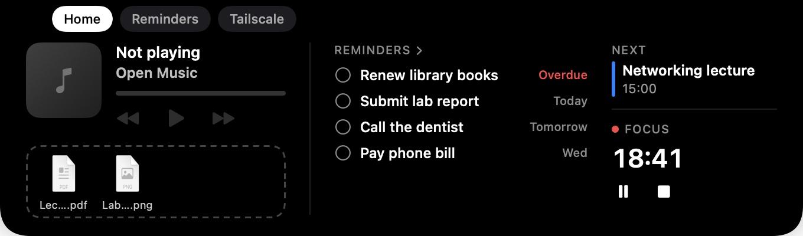

# Notchpad

Notchpad turns the notch on a MacBook into a small panel. Move the mouse onto the notch and it opens with the song playing in Apple Music, a shelf for files, the rest of today's calendar, the chip temperature and the battery. Move the mouse away and it goes back to being a normal black notch.



## What's in the panel

- **Music:** the current Apple Music track with its cover, a progress bar, and previous, play/pause and next. Notchpad never starts Music by itself. If Music is closed, there's an "Open Music" button.
- **Shelf:** drag files onto the notch and they wait there until you drag them out somewhere else. The shelf keeps a link to the original file (no copies) and is still there after a restart. When you drag a file towards the closed notch, the panel opens by itself.
- **Today:** up to three events left today, from every calendar the Calendar app shows (iCloud, Google, work or university).
- **Chip:** the average temperature of the chip's die sensors, in °C.
- **Battery:** percentage, and time left or time to full.
- **Tailscale tab:** a second tab with your Tailscale status, a Connect/Disconnect button and your devices. Click a device to copy its Tailscale IP. It uses the command line tool inside the Tailscale app, so it only works if Tailscale is installed, and it checks every 5 seconds only while the tab is open.

The panel has two tabs at the top left, Home and Tailscale. Right-click the open panel for "Launch at login" and "Quit Notchpad". There's no Dock icon and no menu bar icon.

## Requirements

- A MacBook with a notch (2021 MacBook Pro or newer, 2022 MacBook Air or newer)
- macOS 14 or later
- Apple Music, for the music part

## Build

```bash
brew install xcodegen
git clone https://github.com/alperengokbak/notchpad.git && cd notchpad
scripts/build.sh
open build/Build/Products/Debug/Notchpad.app
```

`scripts/build.sh` signs the app with your "Apple Development" certificate if you have one (Xcode creates it when you sign in with your Apple ID). Otherwise it signs the app for your Mac only. With the certificate, macOS remembers the permissions between builds. Without it, it may ask again after each build.

To run the tests: `swift test --package-path Packages/NotchpadCore`

## First launch

The app isn't notarised by Apple, so the first time you open a copy someone sent you, macOS blocks it. Go to System Settings → Privacy & Security and click "Open Anyway". You only do this once.

Notchpad then asks for two permissions:

- **Calendar:** to show today's events. Nothing leaves your Mac.
- **Automation for Music:** to show the current song and to use the play, next and previous buttons.

If you say no to Calendar, the panel shows "Calendar access is off" with a button that opens the right page in System Settings.

## How the temperature is read

macOS has no public way to read temperatures on Apple Silicon. Notchpad uses the same private IOKit HID calls as tools like Stats and iStat Menus. That's why the app isn't sandboxed and can't be on the App Store. If a future macOS changes these calls, the temperature shows "–" instead of a number.

## Licence

MIT. See [LICENSE](LICENSE).
