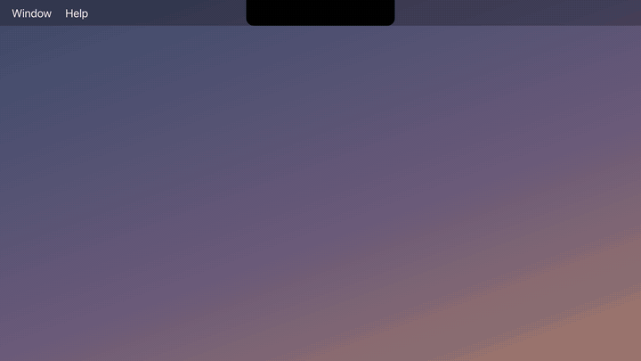

# Notchpad

Notchpad turns the notch on a MacBook into a small panel. Move the mouse onto the notch and it opens with the song playing in Apple Music or Spotify, a shelf for files, your reminders, your next event and a focus timer. Move the mouse away and it goes back to being a normal black notch.




The same video with sound: [notchpad-launch.mp4](docs/notchpad-launch.mp4) (download).

## What's in the panel

- **Music:** the song playing in Apple Music or Spotify, with its cover, a progress bar, and previous, play/pause and next. If you use both, it shows whichever one is playing. When both are paused it stays on the one you used last. Notchpad never starts either app by itself. If the app is closed, there's an "Open Music" or "Open Spotify" button.
- **Shelf:** drag files onto the notch and they wait there until you drag them out somewhere else. The shelf keeps a link to the original file (no copies) and is still there after a restart. When you drag a file towards the closed notch, the panel opens by itself. Hover a file and click the blue AirDrop icon to send it to your iPhone or another Mac, or right-click the panel for "AirDrop all files". If the tab on screen has no Shelf when you drop a file, the panel switches to a tab that has one.
- **Reminders:** your overdue and soonest reminders from every list, with a circle to tick them off. Click the Reminders heading to jump to the tab with the full list. The Reminders app doesn't need to be open.
- **Next:** your next event today, from every calendar the Calendar app shows. At Medium size it lists your next three events today instead of one.
- **Focus timer:** start a 25 or 50 minute session. When you close the panel, the countdown stays visible on a small black strip left of the notch (red dot for focus, green for a break). When the time is up you hear a sound and get a notification, then you can start a 5 minute break or go again.
- **Microphone in use:** when any app uses the microphone, a red mic and how long it's been on appear on the strip left of the notch (next to the focus countdown if one is running). Notchpad never listens itself; macOS only tells it the mic is on, not which app. If you don't want it, right-click the open panel and untick "Show microphone indicator". Notchpad then stops watching the microphone completely.
- **Tailscale:** your Tailscale status, a Connect/Disconnect button and your devices. Click a device to copy its Tailscale IP. It uses the command line tool inside the Tailscale app, so it only works if Tailscale is installed. If the Tailscale app isn't running when you click Connect, Notchpad starts it first. It checks every 5 seconds, and only while the Tailscale widget is on screen.

## Tabs and widgets

Each part of the panel is a widget, and you choose which widgets go on which tab. Right-click the open panel and pick "Edit widgets…". In edit mode you can:

- remove a widget with its minus button, or change its size with the arrows button (Small, Medium, Wide or Full, depending on the widget)
- drag a widget to an empty spot, or onto another widget to swap the two
- click "Add widget" to open the gallery, search or pick a category, and click a widget to add it to the tab you're on
- add a tab with +, click the selected tab to rename it, drag tabs to change their order, or delete a tab with its minus button

| Widget | Sizes |
|---|---|
| Music | Small, Medium |
| Shelf | Small, Medium, Wide |
| Reminders | Medium, Wide, Full |
| Next | Small, Medium |
| Focus timer | Small |
| Tailscale | Medium, Full |

Small is half a column, Medium is one column, Wide is two columns and Full is the whole tab.

Click Done when you're finished. You can have up to four tabs, and the same widget can be on more than one tab. The first time you open this version you get the old layout: Home, Reminders and Tailscale. A widget only loads its data while it's on screen, so widgets on other tabs don't slow anything down.

When there's no more room left of the notch, the next tabs go to the right of it. Your layout is saved in `~/Library/Application Support/Notchpad/layout.json`. If that file gets damaged, Notchpad starts with the default layout.

Right-click the open panel for "Show microphone indicator", "Launch at login" and "Quit Notchpad". There's no Dock icon and no menu bar icon.

## Requirements

- A MacBook with a notch (2021 MacBook Pro or newer, 2022 MacBook Air or newer)
- macOS 14 or later
- Apple Music or Spotify, for the music part

## Build

```bash
brew install xcodegen
git clone https://github.com/alperengokbak/notchpad.git && cd notchpad
scripts/build.sh
open build/Build/Products/Debug/Notchpad.app
```

`scripts/build.sh` signs the app with your "Apple Development" certificate if you have one (Xcode creates it when you sign in with your Apple ID). Otherwise it signs the app for your Mac only. With the certificate, macOS remembers the permissions between builds. Without it, it may ask again after each build.

To run the tests: `swift test --package-path Packages/NotchpadCore`

## First launch

The app isn't notarised by Apple, so the first time you open a copy someone sent you, macOS blocks it. Go to System Settings → Privacy & Security and click "Open Anyway". You only do this once.

Notchpad then asks for these permissions, each once:

- **Calendar:** to show your next event. Nothing leaves your Mac.
- **Reminders:** to show your reminders and tick them off.
- **Automation for Music or Spotify:** to show the current song and to use the play, next and previous buttons. macOS asks once for each app.
- **Notifications:** for the "Focus done" message. The sound plays either way.

If you say no to Calendar, the Next section says "Calendar off". If you say no to Reminders, the panel says "Reminders access is off" with a button that opens the right page in System Settings.

## Licence

MIT. See [LICENSE](LICENSE).
